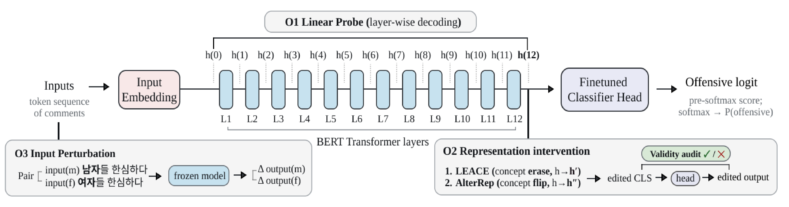
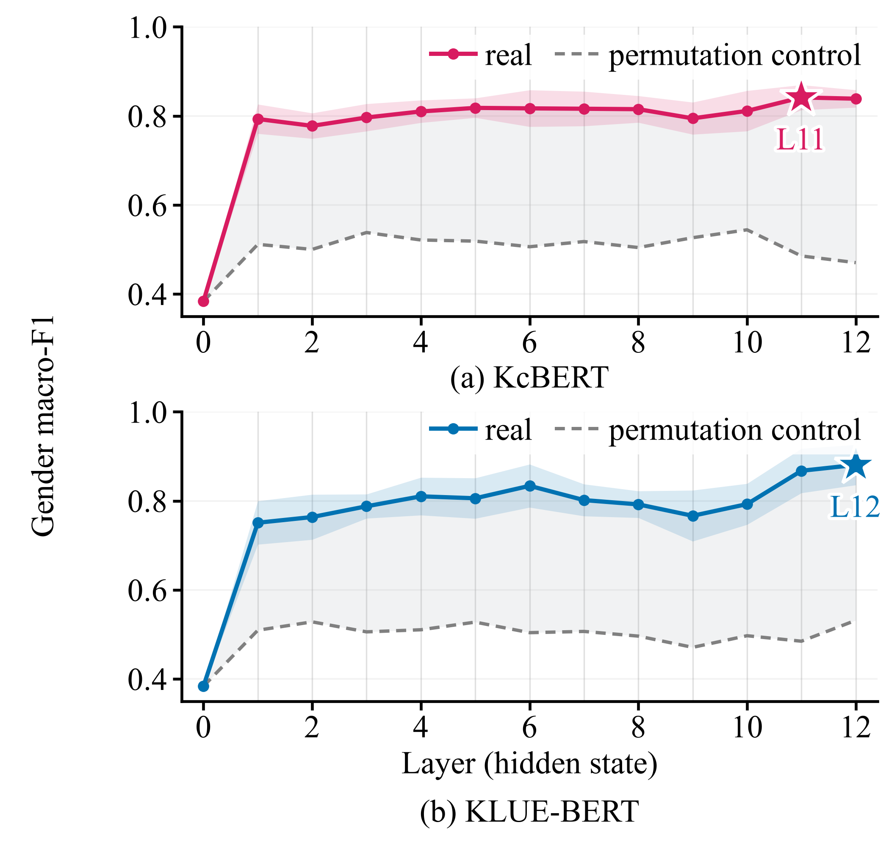
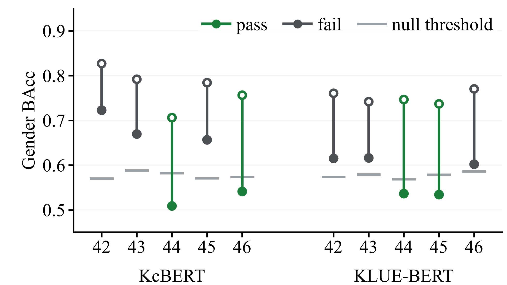
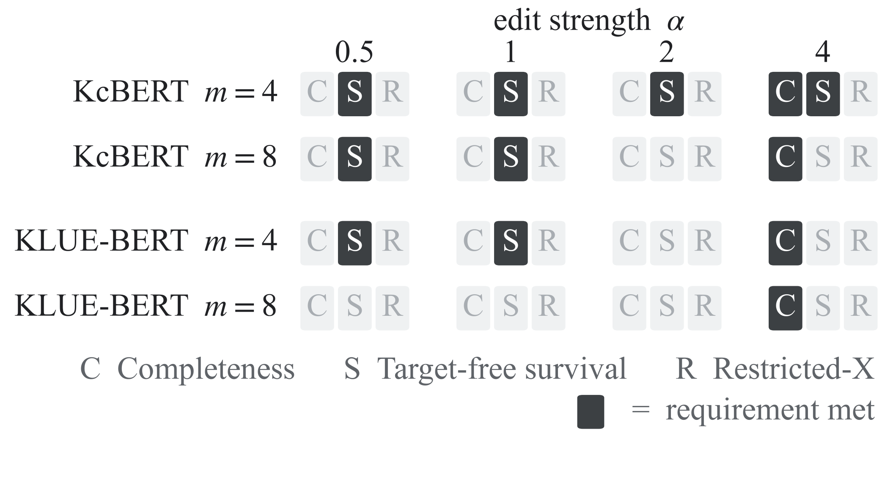

# Gender Information in the Internal Representations of Korean BERT Offensive Language Classifiers: Decodability and Intervention Validity

First-author paper, Korea Software Congress (KSC 2026)

Se-eon Kim, Minkyoung Kim · Kyung Hee University · Undergraduate Paper Track

**English** | [한국어](#한국어)

This study asks what must be checked before a representation intervention can be used to test whether information decoded from a model's internal representations is actually used by the model.

In two Korean BERT offensive-language classifiers, gender was linearly decodable, but no intervention was valid: LEACE did not erase gender consistently across splits, and no AlterRep setting flipped gender while preserving non-target information. The study therefore stops at "use cannot yet be decided" rather than "not used"; judged on a single split, LEACE would have passed as a successful erasure.



**Figure 1.** Overview of the experiments. O1: layer-wise gender decoding. O2: representation intervention and validity evaluation. O3: input-level output evaluation on minimal pairs.

---

## Abstract

That a social attribute can be decoded from a language model's internal representations does not establish that the model uses it for its decisions. A representation intervention can address this question, but its validity must be checked before its output effect is interpreted.

We fine-tuned two Korean offensive-language classifiers (KcBERT and KLUE-BERT) on KOLD and evaluated layer-wise gender decoding, the validity of LEACE erasure and AlterRep flipping, and input-level output differences on gender minimal pairs.

- Gender was linearly decodable at multiple layers of both models.
- LEACE reduced decoding performance in every split, but met the erasure criterion in only 2 of 5 splits for each model.
- AlterRep met individual criteria in some settings, but none of the 8 settings per model met all criteria at once.
- On the minimal pairs, the two models showed different output patterns.

Because no valid intervention was obtained, whether the classifiers use gender information remains unidentified. With a single split, LEACE could have been judged a successful erasure. The study provides empirical evidence that diagnosing bias in language models requires checking target change, preservation of unrelated information, and stability across repeated runs together.

## 1. Background

- High linear-probe accuracy on internal representations does not imply that the original classifier uses that information for prediction [1].
- A standard way to test use is a representation intervention: remove or flip the information in the representation and observe the change in output [2].
- If the intervention does not change the target information enough, an unchanged output is not evidence of non-use. If it also damages other information needed for the offensiveness decision, an output change cannot be attributed to gender. The validity of the intervention must therefore be checked before its output effect is interpreted [3].

Relation to prior work:

- A Korean study analyzed gender bias in KcBERT fine-tuned on KOLD at the output and data-processing level, but did not examine internal representations [6].
- A study on speech recognition (ASR) models combined layer-wise gender decoding with LEACE, but did not check non-target preservation or the stability of the validity decision across repeated runs [7].
- An evaluation framework that checks target change and non-target preservation was tested on a single split [3].

This study reports layer-wise gender decoding in two Korean offensive-language classifiers (O1), evaluates LEACE erasure by whether its erasure criterion holds in all 5 splits and AlterRep flipping by whether target change and non-target preservation are met together (O2), and measures classifier output changes on gender-swapped minimal pairs (O3).

## 2. Methods

### 2.1 Data and models

- From the 40,429 comments in KOLD [8], 1,292 comments were set aside as evaluation candidates. The rest were split into 31,309 training, 3,914 validation and 3,914 test comments.
- KcBERT [9] and KLUE-BERT [10], both 12-layer BERT models, were fine-tuned for binary offensiveness on the same split and then frozen. Test F1 (offensive class) was 0.8307 and 0.8183.
- The two models differ in pre-training data and tokenizer, so differences between them are not attributed to a single cause.
- The 1,292 set-aside comments were not used in fine-tuning. All gender samples for O1 and LEACE come from this set, so the classifiers did not see them during training. Gender samples seen in training were used only to estimate the AlterRep directions, and no comment appears in more than one role.
- The gender task is to tell whether the target group of a comment is male or female. O1 uses 446 gender samples. LEACE in O2 uses 407, after removing comments that overlap with the minimal pairs. AlterRep uses 691 samples to fit the gender directions, 163 to train an independent gender probe, 122 to validate settings and 122 for the final effect test.

### 2.2 Layer-wise gender decoding (O1)

- CLS vectors were extracted from the input embedding (L0) and the Transformer layers (L1–L12).
- At each layer, a linear probe was trained to predict gender from the CLS vector. Macro-F1 was averaged over 5 random splits, with its standard deviation.
- Results were compared with a permutation control trained on shuffled training labels.
- High decoding performance means gender is linearly readable. It does not mean the offensiveness decision uses it.

### 2.3 Representation intervention and validity (O2)

The validity criteria and decision rules were set before any output effect of an intervention was evaluated. Because no intervention was valid, no output effect was evaluated.

**LEACE** [4] removes linearly decodable gender information using the statistical relation between the representation and gender.

- The eraser was fitted on the final layer. A new probe was trained on the erased representations of held-out data and scored by balanced accuracy (BAcc). Before and after erasure were compared on the same cross-validation folds.
- A split met the criterion if the original BAcc exceeded the 95th percentile (q95) of 100 label permutations and the erased BAcc fell to q95 or below.
- This was repeated on 5 splits. Erasure was judged consistent only if the criterion held in every split.

**AlterRep** [5] moves the representation toward the opposite gender within the subspace spanned by gender directions found with INLP.

- The subspace dimension m was 4 or 8 and the edit strength α was 0.5, 1, 2 or 4, giving 8 settings on the final layer.
- An independently trained gender probe was first checked to exceed its permutation q95.
- Three criteria were applied.

| Criterion | Requirement |
|---|---|
| C (completeness) | In both directions, the mean target-gender probability and the target-gender prediction rate are at least 0.70, and both exceed the pre-edit values and the results of 10 random-direction edits |
| S (target-free survival) | On 750 offensive comments with no gender target, the drop in mean offensive probability and in the offensive prediction rate is each at most 0.05 |
| R (restricted-X) | The mean change of a linear offensiveness probe does not exceed the largest change among 10 random-direction edits with the same m and α |

Only settings that met C, S and R were treated as valid interventions, and only then would the output effect be interpreted. S and R are limited measures and do not guarantee that all non-target information is preserved.

### 2.4 Minimal-pair output evaluation (O3)

- 70 automatically selected candidates were reviewed against 16 criteria, including whether anything other than gender changed. 39 minimal pairs with the same context and offensive expression and a different target gender were kept.
- For each pair, Δ = logit_off(female) − logit_off(male). A 95% confidence interval for the mean Δ was computed with 10,000 pair-level bootstrap resamples.
- The result is an input-level difference on these sentence pairs, not direct evidence of an internal use pathway.

## 3. Results

### 3.1 Layer-wise linear decoding of gender



**Figure 2.** Layer-wise gender decoding. Solid line: mean macro-F1 over 5 splits. Dashed line: permutation control. Star: layer with the highest mean.

- Final-layer gender macro-F1 was 0.839±0.020 for KcBERT and 0.881±0.045 for KLUE-BERT.
- The highest mean was at L11 for KcBERT (0.841±0.028) and at L12 for KLUE-BERT.
- The permutation control averaged 0.512 and 0.506 over L1–L12, and real-label performance exceeded the control at every layer from L1 to L12 in both models.
- Gender was therefore linearly decodable at multiple layers. This does not mean the original classifier uses gender.

### 3.2 LEACE erasure validity



**Figure 3.** Gender BAcc before and after LEACE. Open circle: before. Filled circle: after. Grey tick: permutation q95 of each split. Green: the split met the erasure criterion.

- Mean BAcc fell from 0.7734 to 0.6201 for KcBERT and from 0.7514 to 0.5809 for KLUE-BERT, and it fell in every split.
- BAcc reached q95 or below in 2 of 5 splits for both models.
- Since all 5 splits were required to meet the criterion, consistent erasure was not established and the output effect on offensiveness was not evaluated.
- A drop in mean decoding performance and meeting the erasure criterion across splits are separate judgments.

### 3.3 AlterRep intervention validity



**Figure 4.** Which of the three AlterRep criteria (C, S, R) each setting met, by edit strength α and subspace dimension m. A filled cell means the criterion was met.

- The independent gender probe reached BAcc 0.803 (q95 0.614) for KcBERT and 0.726 (q95 0.628) for KLUE-BERT, so both models met the precondition for evaluating flips.
- Across the 8 final-layer settings, C, S and R were met 2, 6 and 0 times for KcBERT and 2, 2 and 0 times for KLUE-BERT. No setting met all three in either model.
- For KcBERT, m=4, α=4 met C and S but not R. For KLUE-BERT, the settings that met C (α=4) and those that met S (m=4, α≤1) did not overlap. Even where gender could be flipped, the non-target preservation criteria were not also met.
- The size of the actual edits also differed from that of the random-direction edits. Failing R therefore does not by itself show that gender and offensiveness information are inherently entangled or that offensiveness information was lost.
- A post-hoc check over L1–L12 found no setting at any layer that passed both the full-data fit and 5 resamples. (The code for this post-hoc check is not included in this repository.)

### 3.4 Gender minimal pairs

**Table 1.** Offensiveness output difference on 39 gender-swapped minimal pairs

| | KcBERT | KLUE-BERT |
|---|---|---|
| Mean Δ [95% CI] | +.009 [−.077, +.106] | +.037 [+.003, +.077] |
| Effect size d_z | +.03 | +.31 |
| Direction (Δ>0 / Δ<0) | 20 / 19 | 25 / 14 |

Δ = logit_off(female) − logit_off(male). n = 39 per model. The 95% CI is from 10,000 pair-level bootstrap resamples.

- For KcBERT, the CI included 0 and the direction split was 20/19.
- For KLUE-BERT, the female version had the higher offensiveness output on these 39 pairs.

## 4. Conclusion and limitations

- Gender was decodable at multiple layers of both classifiers, and the minimal pairs showed different input-level output patterns between the models.
- Because the validity of the interventions was not consistently established, neither observation could be linked to internal use of gender information. Whether gender information is used for the offensiveness decision remains unidentified.
- To interpret decoding results or output differences as evidence of use, the intervention itself must first be shown to work.
- LEACE met the erasure criterion in only some splits; with a single split, erasure could have been wrongly judged successful. For AlterRep, one KcBERT setting passed gender flipping and output preservation but failed non-target representation preservation.
- In both cases the final decision was set by repeated evaluation and the joint satisfaction of several criteria, not by a single split or a subset of measures.

Limitations:

- Performance at or below q95 is a result for the chosen probe and sample and does not guarantee that no gender information remains. Theoretical linear erasure should be distinguished from the held-out performance of a transformation estimated on a finite sample [4].
- The scope is limited to two models, the selected samples, linear interventions centered on the final layer, and limited preservation measures.
- The effects of data composition, transformation estimation, probes and edit size were not separated, so the cause of the failures cannot be determined.

## References

[1] Belinkov, "Probing Classifiers: Promises, Shortcomings, and Advances," Computational Linguistics, 48(1), 207–219, 2022.
[2] Elazar et al., "Amnesic Probing: Behavioral Explanation with Amnesic Counterfactuals," TACL, 9, 160–175, 2021.
[3] Canby et al., "How Reliable Are Causal Probing Interventions?" IJCNLP-AACL, 857–878, 2025.
[4] Belrose et al., "LEACE: Perfect Linear Concept Erasure in Closed Form," NeurIPS, 36, 66044–66063, 2023.
[5] Ravfogel et al., "Counterfactual Interventions Reveal the Causal Effect of Relative Clause Representations on Agreement Prediction," CoNLL, 194–209, 2021.
[6] Lee and Chung, "Detecting Bias in Large Language Models: Fine-Tuned KcBERT," ICPRAI, 76–90, 2025.
[7] Krishnan et al., "On the Encoding of Gender in Transformer-based ASR Representations," INTERSPEECH, 3090–3094, 2024.
[8] Jeong et al., "KOLD: Korean Offensive Language Dataset," EMNLP, 10818–10833, 2022.
[9] Lee, "KcBERT: Korean Comments BERT," HCLT, 437–440, 2020.
[10] Park et al., "KLUE: Korean Language Understanding Evaluation," NeurIPS Datasets and Benchmarks Track, 2021.

---

## Reproducing the results

### Setup

```bash
pip install -r requirements.txt
```

Python 3.13. All analyses run on CPU. Fine-tuning used a Colab T4 GPU.

### Data and checkpoints

- Download `kold_v1.json` from the [KOLD repository](https://github.com/boychaboy/KOLD) and place it at `data/raw/kold_v1.json`.
- The fine-tuned checkpoints are not distributed. Run `finetune/finetune_classifiers.ipynb` and place the resulting `f_kcbert/` and `f_klue/` folders under `checkpoints/`. Retraining with the same split and seed gives test F1 of about 0.83 (KcBERT) and 0.82 (KLUE-BERT); GPU nondeterminism can change the last digits, and later numbers can shift slightly with them.

### Run order

| Step | Script | Output | Paper |
|---|---|---|---|
| 1 | `data/build_target_pool.py` | `data/processed/target_pool.csv` | 2.1 |
| 2 | `data/build_probe_splits.py` | `data/splits/probe_splits.json` | 2.2 |
| 3 | `data/build_minimal_pairs.py` | `data/processed/minimal_pairs_text.json` | 2.4 |
| 4 | `data/build_gender_pool_broad.py` | `data/splits/gender_pool.csv` | 2.1 |
| 5 | `data/build_intervention_roles.py` | `data/splits/intervention_roles.json` | 2.1 |
| 6 | `O2_intervention_validity/build_target_free_controls.py` | `data/splits/target_free_controls.json` | 2.3 (S) |
| 7 | `O1_decodability/extract_cls.py` | `activations/o1_cls_*.npz` | 2.2 |
| 8 | `O1_decodability/layerwise_probe.py` | `results/o1_layerwise_probe.csv` | 3.1 |
| 9 | `O1_decodability/plot_figure2.py` | `figures/figure2_gender_decoding.*` | Figure 2 |
| 10 | `O2_intervention_validity/extract_l12_pool.py` | `activations/o2_l12_*.npz` | 2.3 |
| 11 | `O2_intervention_validity/leace/leace_repeated_splits.py` | `results/o2_leace_repeated_splits.json` | 3.2 |
| 12 | `O2_intervention_validity/leace/plot_figure3.py` | `figures/figure3_leace_repeated_splits.*` | Figure 3 |
| 13 | `O2_intervention_validity/alterrep/alterrep_validity.py` | `results/o2_alterrep_validity.json` | 3.3 |
| 14 | `O2_intervention_validity/alterrep/plot_figure4.py` | `figures/figure4_alterrep_gates.*` | Figure 4 |
| 15 | `O3_minimal_pairs/minimal_pair_eval.py` | `results/o3_minimal_pairs*.{csv,json}` | 3.4 |
| 16 | `O3_minimal_pairs/make_table1.py` | `results/table1_minimal_pairs.csv` | Table 1 |

Run each script from the repository root, e.g. `python data/build_target_pool.py`. The split files in `data/splits/` are already included; steps 2 and 4–6 regenerate them identically. All numbers in `results/` were regenerated with this code and match the paper.

### Notes

- The `effect_audit` role is defined but not used, because no intervention was valid.
- The post-hoc L1–L12 AlterRep check mentioned in 3.3 is not included.
- All numeric settings (seeds, splits, thresholds, grids) are in `configs/`.

## Repository structure

```
configs/                    numeric settings for every step
common/                     paths, config loading, CLS extraction
data/                       scripts that build the pools, splits and minimal pairs
data/splits/                released GUID lists, roles and minimal-pair edits
finetune/                   fine-tuning notebook for the two classifiers
O1_decodability/            layer-wise probes and Figure 2
O2_intervention_validity/   LEACE (Figure 3) and AlterRep (Figure 4)
O3_minimal_pairs/           minimal-pair evaluation and Table 1
results/                    output files behind every figure and table
figures/                    Figures 1-4
```

## Data and license

- KOLD comment text is not redistributed. `data/splits/` contains only KOLD GUIDs, labels and flags. The minimal pairs are stored as GUIDs with character-level edits (the swapped gender word), and `data/build_minimal_pairs.py` rebuilds the text from KOLD.
- KOLD's README states that the data must not be used as training data to automatically generate and publish offensive language.
- Base models: KcBERT (`beomi/kcbert-base`, Apache-2.0), KLUE-BERT (`klue/bert-base`, CC BY-SA 4.0).
- The code in this repository is released under the MIT License.

## Citation

```bibtex
@inproceedings{kim2026gender,
  title     = {한국어 BERT 공격성 분류기의 내부 표현에서 성별 정보 판독과 개입 유효성 평가
               (Gender Information in the Internal Representations of Korean BERT Offensive Language Classifiers: Decodability and Intervention Validity)},
  author    = {Kim, Se-eon and Kim, Minkyoung},
  booktitle = {Proceedings of the Korea Software Congress (KSC 2026)},
  year      = {2026}
}
```

---

## 한국어

### 한국어 BERT 공격성 분류기의 내부 표현에서 성별 정보 판독과 개입 유효성 평가

First-author paper, Korea Software Congress (KSC 2026)

김세언, 김민경 · 경희대학교 · 학부생논문

[English](#abstract) | **한국어**

이 연구는 내부 표현에서 읽히는 정보가 모델 판단에 실제로 쓰이는지 표현 개입으로 검사할 때, 개입의 유효성을 무엇으로 확인해야 하는지를 다룬다.

두 한국어 BERT 공격성 분류기에서 성별은 선형으로 판독되었지만 유효한 개입은 없었다. LEACE는 분할에 따라 소거 기준 충족 여부가 달랐고, AlterRep은 성별 전환과 비목표 보존을 함께 충족한 설정이 없었다. 그래서 결론은 '쓰지 않는다'가 아니라 '쓰는지 아직 판정할 수 없다'에서 멈추며, 분할 하나만 보았다면 LEACE는 소거에 성공한 것으로 판단되었을 것이다.


**그림 1.** 전체 실험 개요. O1: 층별 성별 판독, O2: 표현 개입과 유효성 평가, O3: 최소쌍 입력 기반 출력 평가.

---

### 요약

언어모델 내부 표현에서 특정 사회적 속성이 판독된다는 사실만으로는 모델이 그 정보를 실제 판단에 사용한다고 단정할 수 없다. 이를 확인하기 위한 표현 개입도 출력 효과를 해석하기 전에 유효성을 먼저 검증해야 한다.

본 연구는 KOLD로 미세조정한 두 한국어 공격성 분류기(KcBERT, KLUE-BERT)에서 층별 성별 정보 판독, LEACE 소거와 AlterRep 전환의 유효성, 성별 최소쌍의 입력 수준 출력 차이를 평가하였다.

- 성별 정보는 두 모델의 여러 층에서 선형 판독되었다.
- LEACE 적용 후 판독력은 모든 분할에서 감소했지만, 소거 기준을 충족한 분할은 두 모델 모두 5개 중 2개였다.
- AlterRep은 일부 설정에서 개별 기준을 충족했지만, 각 모델의 8개 설정 중 모든 기준을 동시에 충족한 설정은 없었다.
- 최소쌍에서는 모델마다 출력 양상이 달랐다.

유효한 개입을 확보하지 못했으므로 성별 정보의 사용 여부는 미식별로 남았다. LEACE는 단일 분할만 보았다면 소거에 성공한 것으로 판단할 수 있었다. 본 연구는 언어모델의 편향을 진단할 때 목표 정보의 변화, 무관한 정보의 보존, 반복 실험에서의 안정성을 함께 검증해야 한다는 실증적 근거를 제시한다.

### 1. 배경

- 선형 판독기(linear probe)로 내부 표현에서 정보가 높은 성능으로 판독된다는 사실은 원래 분류기가 그 정보를 예측에 사용한다는 것을 함의하지 않는다 [1].
- 사용 여부를 확인하는 대표적인 방법은 표현에서 해당 정보를 소거하거나 반전한 뒤 출력 변화를 관찰하는 표현 개입이다 [2].
- 개입이 목표 정보를 충분히 바꾸지 못하면 출력이 유지되어도 비사용으로 볼 수 없다. 개입이 공격성 판단에 필요한 다른 정보까지 훼손하면 출력 변화를 성별 정보의 효과로 볼 수 없다. 따라서 출력 효과를 해석하기 전에 개입 자체의 유효성을 먼저 검증해야 한다 [3].

선행 연구와의 차이는 다음과 같다.

- 국내에서는 KOLD로 미세조정한 KcBERT의 성별 편향을 출력과 데이터 처리 단계에서 분석했으나 내부 표현 수준으로 확장하지 않았다 [6].
- 음성인식(ASR) 모델에서 성별 정보의 층별 판독과 LEACE를 결합한 연구는 비목표 정보 보존과 판정의 반복 안정성을 함께 검증하지 않았다 [7].
- 개입의 목표 변화와 비목표 보존을 확인하는 평가법은 단일 분할에서 실험되었다 [3].

본 연구는 두 한국어 공격성 분류기에서 성별 정보의 층별 판독 결과를 제시하고(O1), LEACE 소거는 5개 분할 모두에서 소거 기준을 충족하는지로, AlterRep 전환은 목표 변화와 비목표 보존을 함께 충족하는지로 유효성을 평가하며(O2), 성별어를 바꾼 최소쌍에서 분류기 출력 변화를 측정한다(O3).

### 2. 실험 방법

#### 2.1 데이터 및 분석 대상 모델

- KOLD [8]의 40,429개 댓글에서 후속 평가 후보 1,292개를 분리하고, 나머지를 학습 31,309개, 검증 3,914개, 시험 3,914개로 나누었다.
- 같은 분할로 12층 BERT 모델인 KcBERT [9]와 KLUE-BERT [10]를 공격성 이진 분류에 미세조정한 뒤 고정하였다. 시험 F1(공격 클래스)은 각각 0.8307과 0.8183이다.
- 두 모델은 사전학습 자료와 토크나이저가 다르므로 결과 차이를 한 가지 원인에 귀속하지 않는다.
- 분리한 1,292개는 미세조정에 사용하지 않았다. O1과 LEACE의 성별 표본은 모두 이 중에서 뽑았으므로 분류기가 학습에서 보지 않은 댓글이다. 학습에 노출된 성별 표본은 AlterRep의 방향 추정에만 사용했으며, 역할 사이에 겹치는 댓글은 없다.
- 성별 분석은 문장이 지칭하는 표적 집단이 남성인지 여성인지 구분하는 과제로 구성하였다. O1에는 성별 표본 446개, O2의 LEACE에는 최소쌍과 중복되는 표본을 제외한 407개를 사용하였다. AlterRep은 성별 방향 적합 691개, 독립 성별 판독기 학습 163개, 설정 검증 122개, 최종 효과 평가 122개로 분리하였다.

#### 2.2 층별 성별 판독 (O1)

- 입력 임베딩(L0)과 Transformer 층(L1–L12)의 CLS 벡터를 추출하였다.
- 층마다 CLS 벡터로 성별을 예측하는 선형 판독기를 학습하고, 5개 난수 분할에서 macro-F1의 평균과 표준편차를 구하였다.
- 학습 라벨을 무작위로 섞은 순열 통제와 비교하였다.
- 높은 판독 성능은 성별 정보가 선형적으로 읽힌다는 뜻이며, 공격성 판단에 사용되었다는 뜻은 아니다.

#### 2.3 표현 개입과 유효성 평가 (O2)

유효성 기준과 판정 규칙은 개입의 출력 효과를 평가하기 전에 정하였다. 유효한 개입이 없었으므로 출력 효과는 평가하지 않았다.

**LEACE** [4]는 표현과 성별의 통계적 관계를 이용해 선형 판독 가능한 성별 정보를 제거한다.

- 최종층에서 소거기를 적합한 뒤, 별도 자료의 변환된 표현에 새 판독기를 학습하여 균형 정확도(BAcc)를 평가하였다. 소거 전후는 같은 교차검증 분할로 비교하였다.
- 원본 BAcc가 라벨 순열 100회의 95백분위(q95)보다 높고, 소거 후 q95 이하로 감소하면 해당 분할을 충족한 것으로 보았다.
- 이 평가를 5개 분할에서 반복하고, 모든 분할에서 기준이 재현될 때만 일관된 소거로 판단하였다.

**AlterRep** [5]은 INLP로 찾은 성별 관련 방향들이 이루는 부분공간에서 표현을 반대 성별 쪽으로 이동시킨다.

- 부분공간 차원 m은 4 또는 8, 이동 강도 α는 0.5, 1, 2, 4로 설정하여 최종층의 8개 조합을 검사하였다.
- 독립적으로 학습한 성별 판독기가 순열 q95를 넘는지 먼저 확인하였다.
- 세 기준을 적용하였다.

| 기준 | 내용 |
|---|---|
| C (전환) | 양방향에서 목표 성별의 평균 확률과 판정 비율이 0.70 이상이고, 개입 전 값과 10개 임의 방향 편집 결과보다 모두 높다 |
| S (표적 없는 문장 보존) | 성별 표적이 없는 공격 문장 750개에서 평균 공격성 확률과 공격성 판정 비율의 하락이 각각 0.05 이하다 |
| R (비목표 보존) | 선형 공격성 판독기의 평균 변화량이 같은 m과 α로 수행한 10개 임의 방향 편집의 최대 변화량을 넘지 않는다 |

C, S, R을 모두 충족한 설정만 유효한 개입으로 판단하고, 이 경우에만 출력 효과를 해석한다. S와 R은 모든 비목표 정보의 보존을 보장하지 않는 제한된 지표다.

#### 2.4 최소쌍 입력 기반 출력 평가 (O3)

- 자동 선별한 70개 후보를 성별 외 변경 여부 등 16개 항목으로 검수하여, 문맥과 공격 표현은 같고 표적 성별만 다른 39개 최소쌍을 확정하였다.
- 공격성 logit 차이 Δ = logit_off(여성) − logit_off(남성)을 구하고, 쌍 단위 bootstrap 10,000회로 평균 Δ의 95% 신뢰구간을 산출하였다.
- 결과는 해당 문장쌍의 입력 수준 차이이며, 내부 사용 경로의 직접 증거는 아니다.

### 3. 실험 결과

#### 3.1 성별 정보의 층별 선형 판독


**그림 2.** 층별 성별 판독 성능. 실선: 5개 분할 평균 macro-F1, 점선: 학습 라벨 순열 통제, 별: 평균 성능이 가장 높은 층.

- 최종층 성별 판독 macro-F1은 KcBERT 0.839±0.020, KLUE-BERT 0.881±0.045이다.
- 최고 평균 성능은 KcBERT의 L11(0.841±0.028)과 KLUE-BERT의 L12에서 관찰되었다.
- 순열 통제의 L1–L12 평균은 각각 0.512와 0.506이었고, 두 모델 모두 L1–L12에서 실제 라벨 성능이 통제보다 높았다.
- 따라서 성별 정보는 여러 층에서 선형 판독 가능했다. 이 결과가 원래 공격성 분류기의 성별 정보 사용을 뜻하지는 않는다.

#### 3.2 LEACE 소거 유효성


**그림 3.** LEACE 적용 전후의 성별 균형 정확도(BAcc). 빈 원은 적용 전, 채운 원은 적용 후, 회색 선은 분할별 순열 q95, 녹색은 해당 분할에서 소거 기준을 충족했음을 뜻한다.

- 평균 BAcc는 KcBERT에서 0.7734에서 0.6201로, KLUE-BERT에서 0.7514에서 0.5809로 낮아졌으며 모든 분할에서 감소하였다.
- 소거 후 q95 이하가 된 분할은 두 모델 모두 2/5였다.
- 5개 분할 전체의 기준 충족을 요구한 본 평가에서는 일관된 소거를 확인하지 못했으므로 공격성 출력 효과는 평가하지 않았다.
- 평균 판독 성능의 감소와 분할 전반의 소거 기준 충족은 별개의 판정이다.

#### 3.3 AlterRep 개입 유효성


**그림 4.** 편집 강도 α와 부분공간 차원 m에 따른 AlterRep의 세 기준(C, S, R) 충족 여부. 진한 칸이 해당 기준을 충족한 것이다.

- 독립 성별 판독기의 BAcc는 KcBERT 0.803(q95 0.614), KLUE-BERT 0.726(q95 0.628)으로 두 모델 모두 전환 평가 조건을 충족하였다.
- 최종층 8개 설정에서 C·S·R 충족 수는 KcBERT 2·6·0개, KLUE-BERT 2·2·0개였고, 세 기준을 모두 충족한 설정은 두 모델 모두 없었다.
- KcBERT의 m=4, α=4는 C와 S를 충족했으나 R을 충족하지 못했다. KLUE-BERT는 C를 충족한 설정(α=4)과 S를 충족한 설정(m=4, α≤1)이 겹치지 않았다. 성별 전환이 가능했던 설정에서도 비목표 보존 기준까지 함께 충족하지는 못했다.
- 실제 편집의 크기는 임의 방향 편집과도 달랐다. 따라서 R 불충족만으로 성별과 공격성 정보가 본질적으로 결합되어 있다거나 공격성 정보가 소실되었다고 단정할 수 없다.
- 사후 분석에서 L1–L12를 함께 점검했으나, 어느 층에서도 전체 자료 적합과 5회 재표집을 모두 통과한 설정은 없었다. (이 사후 분석 코드는 저장소에 포함하지 않았다.)

#### 3.4 성별 최소쌍 출력 평가

**표 1.** 성별 교체 최소쌍 39쌍의 공격성 출력 차이

| | KcBERT | KLUE-BERT |
|---|---|---|
| 평균 Δ [95% CI] | +.009 [−.077, +.106] | +.037 [+.003, +.077] |
| 효과 크기 d_z | +.03 | +.31 |
| 방향 (Δ>0 / Δ<0) | 20 / 19 | 25 / 14 |

Δ = logit_off(여성) − logit_off(남성). 모델별 n = 39, 95% CI는 쌍 단위 bootstrap 10,000회로 산출하였다.

- KcBERT의 신뢰구간은 0을 포함했고 방향도 20/19로 비슷했다.
- KLUE-BERT는 이 39쌍에서 여성 표현 쪽의 공격성 출력이 더 높았다.

### 4. 결론 및 한계

- 두 분류기의 여러 층에서 성별 정보가 판독되었고, 최소쌍에서는 모델별로 다른 입력 수준 출력 양상이 관찰되었다.
- 표현 개입의 유효성이 일관되게 확보되지 않아 두 관찰을 내부 성별 정보의 사용으로 연결할 수 없었다. 성별 정보의 공격성 판단 사용 여부는 미식별로 남았다.
- 판독 결과와 출력 차이를 성별 정보 사용의 증거로 해석하려면 개입 자체의 작동을 먼저 확인해야 한다.
- LEACE는 일부 분할에서만 소거 기준을 충족하여, 단일 분할이었다면 소거 성공을 잘못 판단할 수 있었다. AlterRep에서도 KcBERT의 한 설정이 성별 전환과 출력 보존을 통과하고도 비목표 표현 보존에서 탈락했다.
- 두 사례에서 최종 판정은 단일 분할이나 일부 지표의 통과가 아니라 반복성과 여러 기준의 공동 충족으로 결정되었다.

한계는 다음과 같다.

- q95 이하의 성능은 지정한 판독기와 표본에서의 결과이며 모든 성별 정보의 부재를 보장하지 않는다. 이론적 선형 소거와 유한 표본에서 추정한 변환의 별도 자료 성능은 구분해야 한다 [4].
- 해석 범위는 두 모델, 선정한 표본, 최종층 중심의 선형 개입과 제한된 보존 지표에 한정된다.
- 자료 구성, 변환의 추정, 판독기와 편집 크기가 결과에 미친 영향을 분리하지 못했으므로 실패 원인은 확정할 수 없다.

참고문헌 [1]–[10]은 영문 [References](#references) 절을 참고한다. 재현 방법, 저장소 구조, 데이터와 라이선스는 영문 절에 정리하였다.
